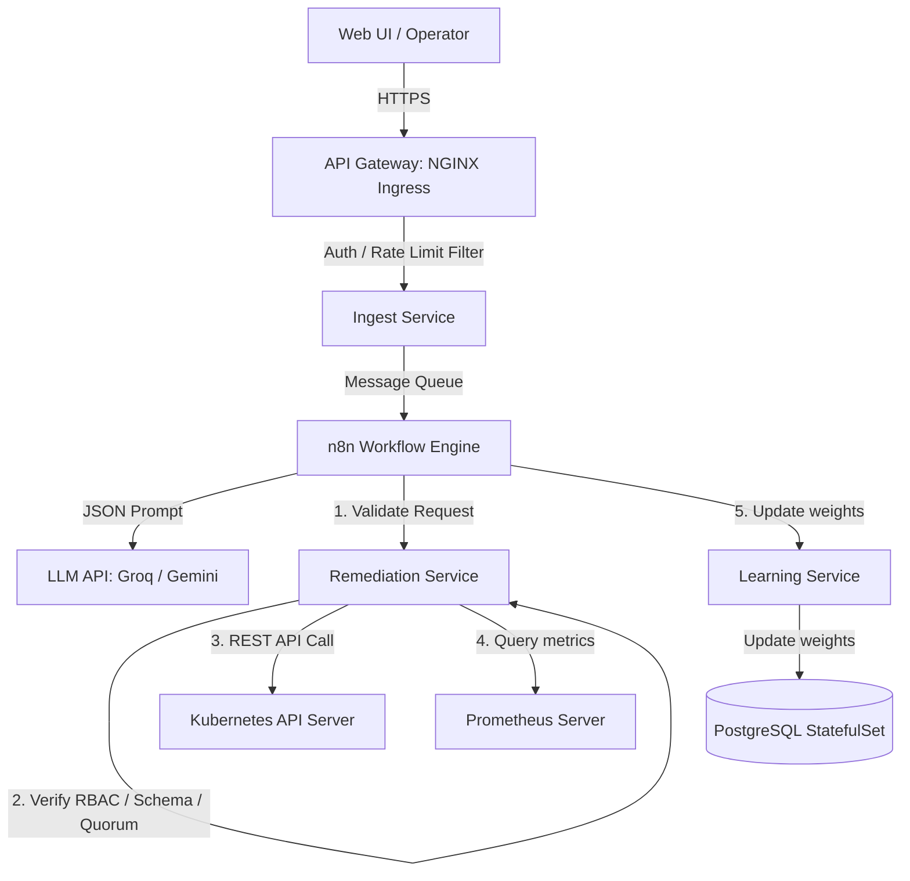

# AutoFlow Target-State Architecture Specification

**Date**: 2026-08-23
**Status**: **APPROVED PLANNING STATE**

---

## 1. Architectural Component Map

---

## 2. Component Specifications & Boundaries

### A. API Ingress Gateway (NGINX Ingress)
- **Responsibility**: Manages cluster edge traffic. Handles SSL/TLS termination, rate limiting, and request routing to backend services.
- **Traffic Protection**: Terminates SSL/TLS certificates. All internal service-to-service communication remains HTTP.
- **Verification Criterion**: Reject unsecured HTTP traffic on port 80; throttle IPs exceeding configuration thresholds.

### B. Ingest & Business Application Layer
- **Responsibility**: Ingests webhook payloads and validates JWT authorization tokens. Evaluates role-based authorization (RBAC) claims before executing protected business logic.
- **Classification**: **MODIFIED** (Includes JWT/RBAC application gatekeeping).

### C. Kubernetes Remediation Service
- **Responsibility**: The execution boundary. Runs under restricted RBAC privileges using a dedicated ServiceAccount. Validates schemas, target namespaces, and action allowlists.
- **Safety Contract**:
  - Request -> Authentication/Authorization -> Schema Validation -> Action Allowlist (Pod Restarts, Deployment Scaling; Node Drains are excluded) -> Target/Namespace Validation -> Idempotency checks -> K8s API execution -> Result verification.
- **RBAC Configuration**:
  - **ServiceAccount**: `remediation-sa`
  - **Role Scope**: Namespace-restricted to deployment target namespaces.
  - **Verbs**: `get`, `list`, `watch`, `patch`, `update`.
  - **Resources**: `pods`, `deployments`.

### D. Recovery Verification (Prometheus Client)
- **Responsibility**: Evaluates system recovery by querying live metrics from Prometheus endpoints.
- **Recovery Predicate**:
  - CPU usage within acceptable limits.
  - Error rate below threshold.
  - Pod/replica readiness counts equal configuration target.

### E. Persistent Database (PostgreSQL StatefulSet)
- **Responsibility**: Stores transactional event logs, decisions, actions, and weights.
- **Initialization**: A clean local database is initialized on startup. Existing historical Neon records are not migrated. Credentials are read from Kubernetes Secrets.

### F. Kubernetes Autoscaling (HPA)
- **Responsibility**: Deploys native Kubernetes Horizontal Pod Autoscaler for routine load-based scaling of microservices.
- **Distinction**: Native HPA handles scale out based on resource thresholds; AutoFlow AI remediation handles corrective action deployment scaling on telemetry anomalies.

### G. DevOps (CI/CD Pipeline)
- **Responsibility**: CI/CD build and deploy automation is classified as **future/optional** scope.
